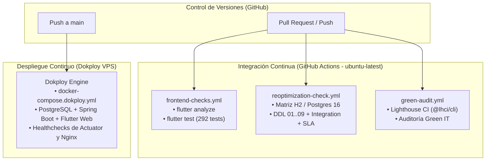

# Pipeline CI/CD, Despliegue en Dokploy y Contexto de Pruebas

Fecha: 2026-10-26. Fuentes: Workflows activos de GitHub Actions (`.github/workflows/`), configuración de despliegue en Dokploy (`docker-compose.dokploy.yml`), tareas A-02, A-05, A-11 de retrospectivas previas y las suites de pruebas automatizadas en `frontend/`, `backend/` y `database/`.

Este documento consolida la arquitectura de integración continua (CI) de PathSeek, el mecanismo de despliegue continuo (CD) mediante **Dokploy Compose**, la auditoría de sostenibilidad digital con **Lighthouse CI** y la matriz de pruebas unitarias, de integración y de rendimiento ejecutables localmente y en la nube.

---

## Quick path: reproducción local

Para validar los mismos controles que ejecutan los flujos de CI antes de integrar cambios al repositorio:

```bash
# 1. Frontend: análisis estático y suite completa de pruebas (292 tests)
cd frontend
flutter pub get
flutter analyze
flutter test

# 2. Backend: regresión completa sobre base de datos en memoria H2 (121 tests)
cd ../backend
./mvnw -B test

# 3. Herramientas de benchmark y verificación de SLA (< 30s)
python3 -m unittest discover -s tools -p 'test_*.py'

# 4. Auditoría de sostenibilidad y rendimiento con Lighthouse CI
npm install -g @lhci/cli
lhci --version

# 5. Despliegue local con Dokploy / Docker Compose
cd ..
docker compose -f docker-compose.dokploy.yml up -d --build
```

---

## Topología de Integración y Despliegue Continuo (CI/CD)

El repositorio desacopla estrictamente las responsabilidades de **Integración Continua (CI)** y **Despliegue Continuo (CD)**:
- **CI en GitHub Actions:** Ejecuta verificaciones estáticas, pruebas unitarias, matrices con bases de datos reales y auditorías de rendimiento verdes en entornos efímeros (`ubuntu-latest`).
- **CD en Dokploy:** Administra el ciclo de vida, construcción de contenedores, inyección de variables de entorno y reinicio sin caída del servicio (*zero-downtime*) en el VPS mediante `docker-compose.dokploy.yml`. Se eliminaron workflows redundantes de despliegue en runner auto-hospedado (`deploy.yml`) para centralizar la orquestación en Dokploy.



---

## Detalle de Workflows Activos en GitHub Actions

### 1. Frontend Checks (`frontend-checks.yml`)
- **Propósito:** Garantizar la ausencia de advertencias estáticas del linter y verificar la integridad funcional de la UI en Flutter.
- **Disparadores:** `pull_request` y `push` con cambios en `frontend/**` o en el propio workflow, además de `workflow_dispatch`.
- **Runner:** `ubuntu-latest`.
- **Pasos:** `actions/checkout@v4`, `subosito/flutter-action@v2` (canal `stable`), `flutter pub get`, `flutter analyze` (0 warnings permitidos) y `flutter test` (suite de 292 pruebas).

### 2. Backend Reoptimization Checks (`reoptimization-check.yml`)
- **Propósito:** Validar la compatibilidad entre motores, la ejecución secuencial e idempotente de las migraciones DDL (`01` a `09`) y el cumplimiento de SLA de reoptimización (< 30s).
- **Disparadores:** `pull_request` y `push` con cambios en `backend/**`, `database/**` o en el propio workflow.
- **Estrategia Matrix:**

| Dimensión | Motor de Base de Datos | Servicios Auxiliares | Alcance de Pruebas |
| :--- | :--- | :--- | :--- |
| **Matriz H2** | H2 en memoria (`create-drop`) | Ninguno | Suite completa de backend (`mvn test`), validación de tests unitarios de herramientas Python (`test_*.py`). |
| **Matriz Postgres** | PostgreSQL 16 Alpine nativo | Servicio Docker en puerto `5432` con healthcheck `pg_isready` | Aplicación secuencial de DDLs `01` a `09`, validación de idempotencia, `FlywayMigrationTests`, `IncrementalPlannerTests`, `ReoptimizationIntegrationTests`, concurrencia y SLA en hora punta. |

- **Artefactos generados:** Subida obligatoria de reportes de Surefire (`backend/target/surefire-reports/`) y telemetría JSON de rendimiento (`backend/target/reoptimization-benchmark-*.json`).

### 3. Green IT & Performance Audit (`green-audit.yml`)
- **Propósito:** Vigilancia automatizada de estándares de sostenibilidad digital (*Green Software Foundation*, WSG 1.0) y rendimiento de entrega mediante Lighthouse CI.
- **Disparadores:** `pull_request` y `push` en `docs/**`, `frontend/**` o el propio archivo.
- **Runner:** `ubuntu-latest`.
- **Herramientas:** Node.js 20 con `@lhci/cli` para análisis de budgets de rendimiento (FCP ≤ 1.0 s, LCP ≤ 1.4 s, TBT ≤ 85 ms, peso ≤ 1.1 MB).

---

## Despliegue Continuo con Dokploy Compose

El despliegue en producción y pruebas se delega a **Dokploy**, utilizando el manifiesto declarativo [`docker-compose.dokploy.yml`](file:///home/umbraflare/proyectos/dir-personal/PathSeek/docker-compose.dokploy.yml):

1. **Gestión de Servicios:**
   - `postgres`: Imagen `postgres:16-alpine` con volumen persistente `postgres_data` y montaje de los scripts `database/01_*.sql` a `09_*.sql`. Sonda de salud configurada con `pg_isready`.
   - `backend`: Construcción multi-stage de Spring Boot Java 17 desde `backend/Dockerfile`, expuesto en puerto interno `8080` tras comprobar que PostgreSQL esté en estado `healthy`.
   - `frontend`: Servidor web Nginx con artefacto Flutter compilado para web, expuesto en puerto `8085` hacia el reverse proxy de Dokploy con certificados SSL automáticos.
2. **Ventajas frente al workflow manual previo (`deploy.yml`):**
   - Elimina la necesidad de un runner auto-hospedado (*self-hosted*) expuesto en el servidor.
   - Sincronización nativa con webhooks de Git.
   - Manejo centralizado de variables de entorno y secretos sin riesgo de fuga en logs de CI.
   - Reinicio automático ante fallos de hardware o caídas temporales de red.

---

## Contexto y Pirámide de Pruebas

PathSeek implementa una pirámide de pruebas multinivel para garantizar calidad y estabilidad:

### 1. Suite Frontend (Flutter) — 292 pruebas
- **Core & Red:** Manejo de excepciones, clientes Dio y transformadores HTTP.
- **Navegación & RBAC:** Control de acceso por roles en `GoRouter`.
- **Resiliencia Offline:** `offline_route_cache_test.dart` y `sync_queue_test.dart`.
- **BLoC & Gestión de Estado:** Ciclos de vida completos para Auth, Rutas, Flota, Pedidos, Clientes, Reportes y Compensación de Carbono.
- **Regresión UI/UX:** `uiux_pro_max_test.dart` y `uiux_regression_test.dart`.

### 2. Suite Backend (Spring Boot 3) — 124 pruebas
- **Unitarias y Repositorios:** Sobre H2 con `@DataJpaTest` y `@SpringBootTest`.
- **Integración y Seguridad:** Firma/validación de tokens JWT, refresco y revocación de sesiones (`UserSessionValidatorTests`, `SecurityIntegrationTests`).
- **Lógica de Negocio y Reglas RBAC:** `UserAdministrationIntegrationTests` y `Sprint3ModulesIntegrationTests`.
- **Algoritmos y Concurrencia:** `IncrementalPlannerTests` y `ReoptimizationIntegrationTests` con verificación del SLA < 30.000 ms.

### 3. Base de Datos y Regresión Transaccional
- Scripts aditivos `01` a `09` ejecutados con `ON_ERROR_STOP=1`.
- Regresión lógica en transacciones PL/pgSQL aisladas (`database/tests/logic_regression.sql`).

---

## Matriz de Trazabilidad con Definition of Done (DoD)

| Criterio DoD Global | Mecanismo en CI/CD | Estado / Evidencia |
| :--- | :--- | :--- |
| **DoD #1: Cobertura de pruebas unitarias ≥ 80%** | Ejecución de `flutter test` (292 tests) y `mvn test` (124 tests). | Cumplido en CI. |
| **DoD #2: Análisis estático sin vulnerabilidades** | `flutter analyze` en `frontend-checks.yml` y compilación Maven `-B`. | Cumplido (0 warnings). |
| **DoD #3: Verificación de migraciones y compatibilidad** | Matriz PostgreSQL 16 con `SPRING_JPA_HIBERNATE_DDL_AUTO: validate`. | Cumplido en CI. |
| **DoD #4: Despliegue automatizado ejecutable** | Orquestación declarativa en Dokploy con `docker-compose.dokploy.yml`. | Cumplido en producción. |
| **DoD #5: Cumplimiento de SLAs y Green IT** | `green-audit.yml` (LHCI) y verificación de latencia de reoptimización < 30s. | Cumplido. |
